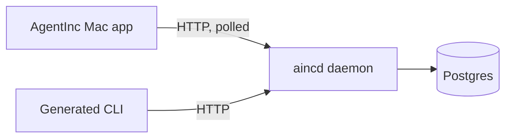

# AgentInc architecture

AgentInc is a personal life OS: a native macOS app over a local daemon. Today it has an Overview, a Smart Home panel, Todos and a Calendar. Agents, on the Turnkeel SDK in this repository, are the planned next layer; when they arrive they will use the same commands a person does. [CONTEXT.md](../CONTEXT.md) defines product language, and [ADRs](adr/) record the decisions (several ADRs describe the agent layer that was built once and removed on 2026-10-12; they stay as history).

## Pieces

The macOS app is **AgentInc**, bundle ID `co.worldwidewebb.agentinc`, a GPUI client with our own components (`crates/ainc-mac`). A `Route` catalogue names destinations; `Page` views render them in a tabbed shell. The Smart Home page works on local state until the house is wired in.

The daemon `aincd` (`crates/ainc-daemon`) owns the API, authorization, domain commands, migrations and Postgres data: Workspaces, Todos and Events. Every mutation is a command on `POST /v1/<resource>/commands` with a UUID operation ID; the change and its receipt commit together, so a replay returns the original result and a changed payload is a conflict. Lists are whole snapshots the clients poll. The installed app starts the daemon as a companion with a bundled Postgres ([distribution.md](distribution.md), [ownership.md](ownership.md)).

The CLI and Rust client are generated from one checked-in OpenAPI contract (`api/`) by `cargo xtask generate`. Every request carries `Agent-Inc-Client`, for example `mac/1.4.2 (build 812; api 1)`; the server sets a minimum client version and returns one typed **upgrade required** error below it, which the app handles in one generic screen ([ADR 0008](adr/0008-client-server-version-contract.md)).

## Development

`cargo xtask dev` starts the worktree's Tilt + Compose stack (Postgres) and the native daemon and app. A worktree's canonical path determines its instance identity, so two worktrees run side by side with their own Compose project, database and ports. `cargo xtask doctor` shows the identity; `cargo xtask down` stops the stack without deleting volumes. `dev/check-isolation.sh WORKTREE_A WORKTREE_B` exercises two disposable worktrees.

## Release

One product version drives the app bundle and the companion daemon; the SDK may version independently. **Sparkle owns the update engine** behind AgentInc's own update UI ([ADR 0011](adr/0011-sparkle-update-engine.md)). The release pipeline is in [how-to.md](how-to.md), [release-runner.md](release-runner.md) and [upgrade-gate.md](upgrade-gate.md).

## Turnkeel

The SDK (`crates/turnkeel`) runs one agent durably on Temporal, which stays hidden behind its private engine. Its runtime foundation is in [runtime.md](runtime.md). Nothing in the product depends on it today.
